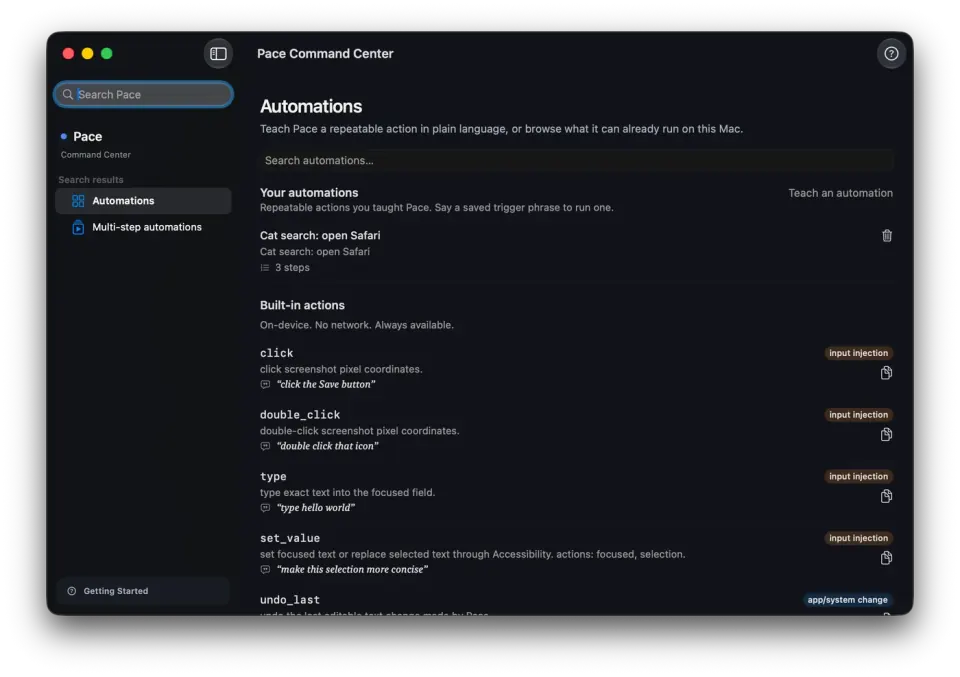

# Pace

Pace is a menu-bar assistant for Mac. Ask about the screen in front of you, point to a control, or give an app a task. You can choose a local planner or let Codex plan with the screen context you permit.

[Download for Mac](https://heypace.app/download) · [Product website](https://heypace.app/) · [Release notes](https://github.com/HeyPace/pace/releases/latest)

## Start with the public preview

**0.3.20** is the public download for Apple Silicon Macs running macOS 26 or later. Drag Pace into Applications, open it from the menu bar, and type a question such as “What does this message mean?” Turn on **Read My Screen** to include the current view. Enable actions and grant Accessibility access when you want Pace to operate an app.

The public preview can open apps and Chrome profiles, use Peekaboo for desktop actions and Playwright for browser actions, teach reusable routines, and open Codex in Warp in a chosen project folder. It also supports sourced research, screen recording, and local meeting notes. The signed release was checked with typed requests. Voice accuracy and the microphone hotkey were outside its release checks.



## What’s in the 0.3.21 development build

| Try saying or typing | What happens |
| --- | --- |
| “Show me a rotatable airplane and explain its parts.” | A labeled figure appears over the desktop. Drag to rotate it, select a part, or play a narrated lesson. Closing the figure stops its narration. |
| “Scroll down.” | Pace can scroll locally when the pointer is over the active window. A request naming a specific pane uses screen context. |
| “What are my tasks?” | Pace requests Apple Reminders access and can list, create, reschedule, complete, or remove tasks. |
| “Add a Power that plays a greeting and says thank you.” | Describe the behavior, save it, and run it by name. Custom Powers can present local media, drawings, or interactive cards. You can update, disable, or remove them later. |
| “Resume my coding session.” | Continue a retained coding task in its workspace. Pace can report progress or cancel a session. |

Hold **Right Option** to speak, or type in the notch. Typed requests get written replies. Spoken requests can receive a voice reply and appear in the same history. With Japanese practice configured, Pace can speak Japanese with an English subtitle. Opt-in Watch mode can take notes and offer suggestions you can ask it to explain.

These features are available in the [development source](https://github.com/HeyPace/pace/tree/fix/pace-pane-scroll). See its [capability guide](https://github.com/HeyPace/pace/blob/fix/pace-pane-scroll/docs/product/capabilities.md) for supported commands, voice setup, and Power limits.

## Privacy and providers

Speech recognition, local voices, conversation storage, and meeting-note synthesis can run on the Mac. With an external planner enabled, requests can include your prompt and permitted screen captures. An amber indicator marks off-device planning, and the local audit log records the request. External planners and integrations use their own accounts, limits, and pricing.

## Build and test

Open the Xcode project on macOS, select the `leanring-buddy` scheme, and run it from Xcode. The repository provides isolated tests and a latency report for your own sessions.

```sh
open leanring-buddy.xcodeproj
bash scripts/test-pace.sh
bash scripts/benchmark_ttfsw.sh --last 10m
```

[Local setup](SETUP_LOCAL.md) · [Architecture](docs/architecture/overview.md) · [Test coverage](docs/development/test-coverage.md) · [Website development](website/README.md) · [MIT license](LICENSE)
